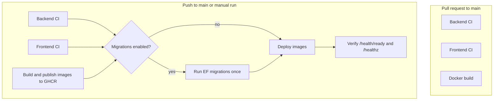

# CI/CD

Ledgerline uses GitHub Actions for continuous integration and delivery. There is no
hosting target configured in this repository, so image publishing is automated while the
final rollout step is an explicit, documented placeholder.

## Pipeline



| Workflow | File | Trigger | Purpose |
|---|---|---|---|
| Backend CI | `.github/workflows/backend-ci.yml` | PR, push to `main`, reusable | Restore, Release build, xUnit tests, TRX artifact |
| Frontend CI | `.github/workflows/frontend-ci.yml` | PR, push to `main`, reusable | `npm ci`, oxlint, `tsc -b`, production build |
| Docker build | `.github/workflows/docker-build.yml` | PR, push to `main`, reusable | Compose validation, build API/web/migration images, optional GHCR push |
| CD | `.github/workflows/cd.yml` | push to `main`, `workflow_dispatch` | Run CI, publish immutable images, migrate, deploy, health check |

The three CI workflows are reusable (`workflow_call`). `cd.yml` calls them as jobs, so a
commit is never deployed unless those exact checks pass on that commit.

### Integration tests

The backend suite runs against PostgreSQL through Testcontainers (`postgres:17-alpine`).
GitHub-hosted `ubuntu-latest` runners ship a Docker daemon, so the workflow verifies
`docker info` up front and lets the containers run normally. Tests create their own
container per test class and apply migrations inside it; CI needs no database secrets.

## Required repository settings

1. **Actions permissions** — Settings → Actions → General → Workflow permissions.
   Leave the default `GITHUB_TOKEN` read-only; each workflow requests only what it needs
   (`contents: read`, plus `packages: write` for image publishing).
2. **Environments** — Settings → Environments → create `production`.
   - Add required reviewers to gate deployment.
   - Add the environment secrets and variables listed below.
3. **Package visibility** — after the first publish, set the `ledgerline-api`,
   `ledgerline-web` and `ledgerline-migrate` packages to the visibility you need.
   Private packages require authentication to pull.
4. **Branch protection** on `main` — require the `Backend CI`, `Frontend CI` and
   `Docker build` checks.

## Secrets and variables

Environment `production` secrets (never commit these):

| Secret | Purpose |
|---|---|
| `PRODUCTION_CONNECTION_STRING` | Npgsql connection string for the production database |
| `JWT_SIGNING_KEY` | Access-token signing key, at least 32 characters |
| `WEBHOOK_SIGNING_SECRET` | Fallback provider signing secret |
| `WEBHOOK_MOCK_SIGNING_SECRET` | Mock provider signing secret |
| `WEBHOOK_STRIPE_SIGNING_SECRET` | Stripe-shaped provider signing secret |
| `WEB__PUBLIC_BASE_URL` | Public web base URL used in confirmation links |

Repository or environment variables:

| Variable | Purpose |
|---|---|
| `DEPLOY_ENABLED` | `true` enables migration, rollout and health checks. Anything else makes the deploy job report that deployment is not configured. |
| `API_BASE_URL` | Base URL probed at `/health/ready` |
| `WEB_BASE_URL` | Base URL probed at `/healthz`, also the environment link in the UI |
| `VITE_API_URL` | Optional build-time API base for the web image (defaults to `/api`) |

`GITHUB_TOKEN` authenticates to GHCR; no long-lived registry token is stored.

## Container registry (GHCR)

Images are published to GitHub Container Registry using immutable commit SHA tags:

```text
ghcr.io/<owner>/ledgerline-api:<commit-sha>
ghcr.io/<owner>/ledgerline-web:<commit-sha>
ghcr.io/<owner>/ledgerline-migrate:<commit-sha>
```

`latest` is additionally published only for pushes to `main`. Pull requests build both
images with `push: false`, so validation never writes to the registry. Build caching uses
the GitHub Actions cache (`type=gha`), scoped per image.

## Running a deployment

**Automatic** — merge to `main`. CI runs, images publish, then migrations and rollout run.

**Manual** — Actions → **CD** → *Run workflow*:

| Input | Meaning |
|---|---|
| `image_tag` | Commit SHA of an existing image set. Leave empty for the current `HEAD`. |
| `run_migrations` | Run EF Core migrations before rollout (default on). |

A manual run skips rebuilding and reuses the published images, which makes it the
rollback path.

**Deploying a specific image without any migration step** exists for rollouts that do not
change the schema: set `run_migrations` to false.

## Database migrations

- `Program.cs` only calls `MigrateAsync()` when the environment is `Development`.
  Production does **not** migrate on startup, and `Database:MigrateOnStartup` is not read
  by the application.
- Migrations therefore run exactly once per deployment, as a dedicated `deploy` step,
  before the application rollout, using the `ledgerline-migrate` image
  (`dotnet ef database update --no-build --configuration Release`).
- The step fails the deployment if `PRODUCTION_CONNECTION_STRING` is missing, and the
  connection string is passed with `--env-file` so it does not appear in the process list.
- Never run migrations from every replica: keep `run_migrations` on a single gated job,
  as implemented here.
- No deployment step drops, resets or recreates the database. There is no `EnsureDeleted`.

## Health checks

- API: `GET /health/ready` must return HTTP 200 with `"status": "Healthy"` (the readiness
  probe includes the database check). The workflow retries for about two minutes.
- Web: `GET /healthz` on the nginx container must return 200.
- The deployment fails if either check does not pass.

## Rollback

1. Find the last good commit SHA.
2. Actions → **CD** → *Run workflow* with that `image_tag`.
3. If the release changed the schema, migrations are forward-only here. Either deploy a
   compensating migration, or restore the pre-deployment database snapshot. Take a
   snapshot (or provider equivalent) before every deployment that includes migrations.

Limitations:

- No automatic down-migration; EF Core migrations are not reversible in this setup.
- Application rollback is only safe if the previous version tolerates the current schema.
- Image rollback requires the previous SHA tag to still exist in GHCR.

## Inspecting failures

- Actions tab → select the run → the failing job shows the failing step.
- Backend: download the `backend-test-results` artifact for the TRX file; the job summary
  shows the passed/failed/skipped counts.
- Frontend: the job log shows the failing oxlint rule, `tsc` error, or build error.
- Docker build: the failing `docker/build-push-action` step logs the failing stage.
- Deploy: check whether the environment approval, the migration step, or a health check
  failed. Migration failures include the EF Core output.

## Known gaps

These are real limitations of the current codebase, not workflow omissions:

1. **No frontend test suite.** CI enforces lint, typecheck and build, and prints an
   explicit warning that tests are missing. Adding a runner is a separate change.
2. **CORS is hardcoded** to `http://localhost:5173` in `Program.cs`. A deployment where
   the web app and API are on different origins needs a configuration-driven origin list
   before it will work in a browser.
3. **`AllowedHosts`** is `localhost;127.0.0.1` by default and host filtering is enforced.
   Each environment must set `AllowedHosts` (for example `api.example.com`).
4. **Data Protection keys are not persisted.** Per-tenant webhook secrets are encrypted
   with the default key ring, so a container restart can make existing secrets
   unreadable. Configure a shared key ring before a production rollout.
5. **No hosting target.** The deploy step is a documented placeholder that fails loudly
   rather than pretending to deploy.
6. **Email delivery** uses the development outbox/logging sender unless a real provider
   is configured, so production sign-up confirmation needs an email sender.
